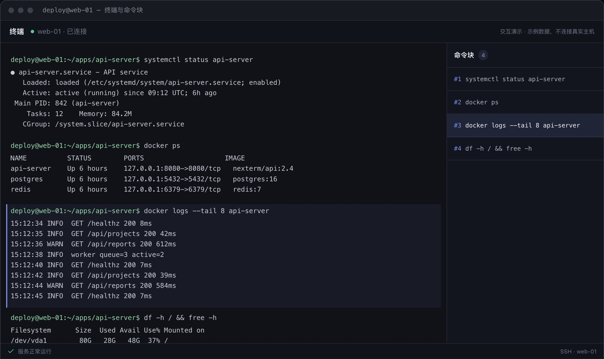
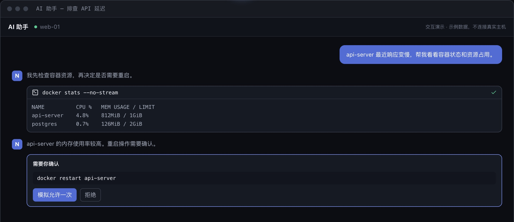
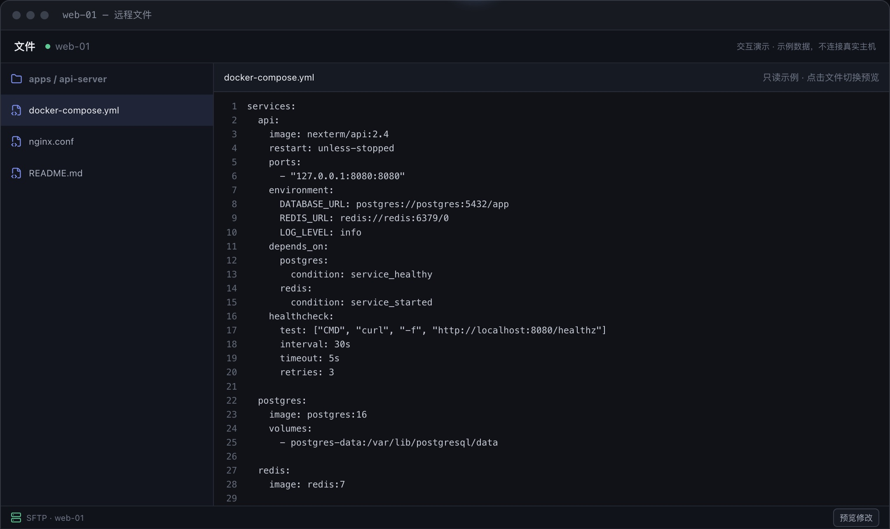
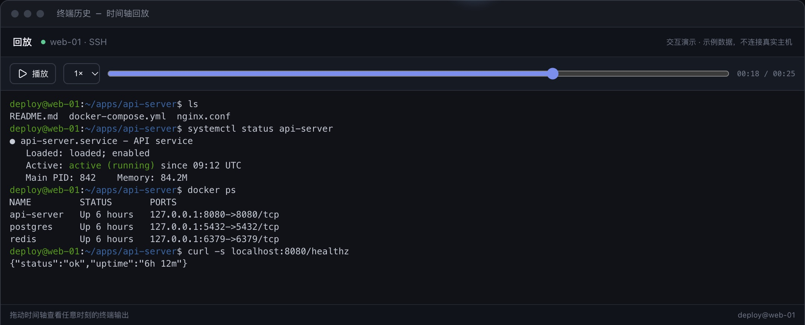

<div align="center">


# NexTerm

**一个可自托管的工作台，管好每一台服务器。**

可接管的持久终端 · 会动手的 AI 助手 · 文件、Docker、数据库、设备管理与终端分享

[](https://nexterm.work/)
[](https://github.com/Hello-CTF/NexTerm/releases/latest)


**中文** | [English](README_EN.md)

[官网](https://nexterm.work/) · [下载](https://github.com/Hello-CTF/NexTerm/releases/latest) · [部署服务端](#部署服务端)

</div>

<picture>
  <source media="(prefers-color-scheme: light)" srcset="website/public/images/shell-light.jpg" />
  
</picture>

NexTerm 把远程运维放进一个窗口：通过 SSH、WinRM 或设备 agent 连接主机，让 AI 助手在你确认后排查和修复问题，再处理文件、容器、数据库、设备监控和终端分享。图片使用示例数据，可在[官网](https://nexterm.work/)体验在线演示。

## 功能

- **🤖 会动手的 AI**：20+ 工具覆盖命令、文件、Docker 和终端输出；执行前展示命令或 diff，支持计划模式、按主机和路径授权、定时任务和长期记忆；兼容任意 OpenAI 接口，内置 DeepSeek、Kimi、GLM、Ollama 预设。
- **🖥️ 持久终端**：启用持久终端的 SSH 会话和受管设备会话在关闭标签、App 重启或断网后继续运行，可从任意已登录设备接管并补回输出；主机上无法启用持久终端组件时退回普通终端，普通终端断开即结束。支持多设备同看、命令块、历史搜索与回放、分屏、命令广播和片段。
- **🧰 日常运维**：SFTP/WinRM/设备文件浏览与在线编辑；Docker 容器、日志与镜像；MySQL/MariaDB、PostgreSQL 与 Redis；本地转发与 SOCKS5；从 `~/.ssh/config` 或 Termius（仅 macOS）导入主机，支持单跳 `ProxyJump`，多跳条目需手动添加。
- **🛰️ 设备与分享**：一行命令接入设备 agent，设备主动外连并上报指标；终端可分享为限时公开链接或分享给注册用户（仅终端，不含文件、转发和 AI），默认只读、可随时吊销，无需交出密码或私钥；浏览器模式可授权写入，桌面端创建的公开链接只读。
- **🔐 自托管**：多用户与 TOTP 双因素认证；端到端加密同步；凭据保险库（主密码、DPAPI/钥匙串或生物识别）；审计日志；数据库可选 SQLite、PostgreSQL、MySQL、MariaDB。浏览器模式下终端和工作区保存在服务端，关掉网页也能继续。

<table>
<tr>
<th width="33%">AI 助手</th>
<th width="33%">远程文件</th>
<th width="33%">终端回放</th>
</tr>
<tr>
<td><picture><source media="(prefers-color-scheme: light)" srcset="website/public/images/ai-light.jpg" /></picture></td>
<td><picture><source media="(prefers-color-scheme: light)" srcset="website/public/images/files-light.jpg" /></picture></td>
<td><picture><source media="(prefers-color-scheme: light)" srcset="website/public/images/replay-light.jpg" /></picture></td>
</tr>
</table>

## 下载

从 [Releases](https://github.com/Hello-CTF/NexTerm/releases/latest) 下载：

| 平台 | 安装包 |
| --- | --- |
| Windows 10/11（amd64 / arm64） | `nexterm-desktop_windows_<架构>_x.y.z.exe` |
| macOS（arm64 / amd64） | `nexterm-desktop_macos_<架构>_x.y.z.dmg` |
| Linux 桌面（amd64 / arm64） | `nexterm-desktop_linux_<架构>_x.y.z.deb`，用 `apt install ./<包名>.deb` 安装 |
| Linux 服务器 | 见[部署服务端](#部署服务端) |
| Android（预览，arm64） | `nexterm-desktop_android_arm64_x.y.z.apk` |
| iOS / iPadOS（预览） | [加入 TestFlight 测试](https://testflight.apple.com/join/ds62pzPz)，Release 不提供 IPA |
| 懒猫微服（amd64） | 应用中心 |

移动端为预览版，完成真机签名验收前不作为正式支持平台。桌面版会自动检查更新，安装前按 `SHA256SUMS` 校验。Windows 安装包没有代码签名，提示未知发布者时选择「更多信息 → 仍要运行」。macOS 提示无法验证开发者时，在「系统设置 → 隐私与安全性」点「仍要打开」；提示已损坏则执行 `xattr -dr com.apple.quarantine /Applications/NexTerm.app`。

**快速开始**：新建 SSH 或 WinRM 资产（也可用内置的「当前设备」）→ 在「设置 → 凭据保护」初始化凭据库后保存密码或私钥 →（可选）在「设置 → AI 模型」接入模型 →（可选）在「设置 → 账号同步」登录服务端，多设备同步。保护密码只用于本机解锁，忘记后已保存的凭据无法恢复。

## 部署服务端

在带 systemd 的 Linux（amd64 / arm64）上以 root 运行：

```bash
curl -fsSL https://nexterm.work/install.sh | sudo bash
```

脚本下载最新服务端包，按 `SHA256SUMS` 校验后执行包内的 `install.sh`：创建 `nexterm` 用户和目录，生成 master key，创建超管 `admin` 并在安装输出中打印一次初始密码（请立即记下，首次登录需修改；也可用 `NEXTERM_ADMIN_PASSWORD` 预先指定），然后启动 `nexterm-server`。重复运行即升级（服务会短暂重启），配置和数据保留，撤销上次升级追加 `--rollback`。指定版本用 `curl -fsSL https://nexterm.work/install.sh | sudo bash -s -- --version x.y.z`；也可以下载 `nexterm-server_linux_<架构>_x.y.z.tar.gz` 解压后执行 `sudo ./install.sh`。

- 服务默认只监听 `127.0.0.1:8080` 且要求登录，可在本机执行 `ssh -L 8080:127.0.0.1:8080 用户@服务器` 后打开 `http://localhost:8080`；配置在 `/etc/nexterm/nexterm.env`，改完执行 `systemctl restart nexterm-server`。
- `--auth off` 会关闭账号、管理与设备路由，任何能连到监听地址的人都能操作服务端，不能用于公网。
- 公网访问请前置带 TLS 的反向代理，代理覆盖设置 `X-Forwarded-Proto`，并把代理来源 IP 段写入 `NEXTERM_TRUSTED_PROXY_CIDRS`。
- 默认使用 SQLite；用 `NEXTERM_DB=postgres|mysql|mariadb` 和 `NEXTERM_DB_DSN` 切换外部数据库，同一数据库只运行一个实例。
- 备份 `/var/lib/nexterm`、`/etc/nexterm/master.key` 和外部数据库。完整说明见包内 `README.md` 和 `nexterm-server --help`。

**懒猫微服**：应用中心安装即可用（目前仅 amd64 机型），内置端口转发不可用，请使用平台转发。

**设备接入**：超管在「设备管理」（浏览器模式，或桌面端登录服务端账号后）配置接入地址并签发一次性接入码，在设备上执行面板给出的一行命令（Linux/macOS 用普通用户，Windows 用 PowerShell），agent 会随用户登录自动启动。

## 开发

工具链：Go 1.26、Node 24+、pnpm。

```bash
pnpm install && pnpm build && go build ./...
task check
```

从最新 `master` 切分支，经 PR 合回；提交和 PR 标题遵循 Conventional Commits。开发、测试和协作约定见 [AGENTS.md](AGENTS.md)，本地数据库环境见 [deploy/dev/README.md](deploy/dev/README.md)。

## License

[MIT](LICENSE)
