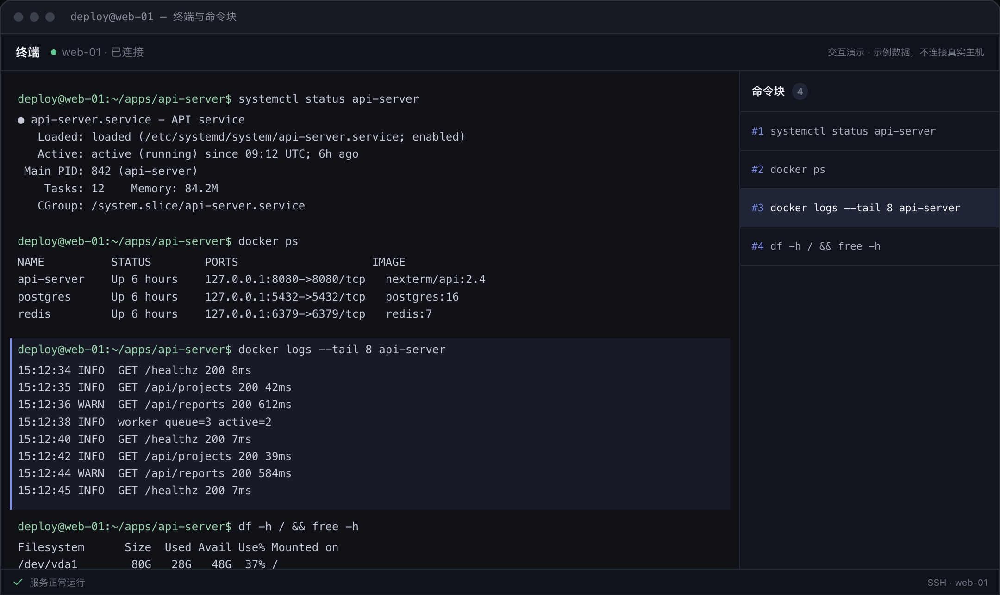

<div align="center">


# NexTerm

**一个可自托管的工作台，管好每一台服务器。**

[](https://nexterm.work/)
[](https://github.com/Hello-CTF/NexTerm/releases/latest)


**中文** | [English](README_EN.md) · [官网与在线演示](https://nexterm.work/) · [下载](https://github.com/Hello-CTF/NexTerm/releases/latest) · [部署服务端](#部署服务端)

</div>

<picture>
  <source media="(prefers-color-scheme: light)" srcset="website/public/images/shell-light.jpg" />
  
</picture>

## 核心特性

- **持久终端**：关闭 App 或断网后继续运行，回来接管并补回输出
- **AI 助手**：读取终端、文件和容器排查问题，写操作经你确认
- **日常运维**：远程文件、Docker、MySQL / PostgreSQL / Redis、端口转发
- **所有连接**：SSH、WinRM、本机终端、受管设备、RDP / VNC
- **自托管**：多用户、双因素认证、审计日志、加密同步

同步不是端到端加密：登录时密码会发送给服务端，请只登录你信任的服务端并使用 HTTPS（详见[安全说明](docs/security.md)）。完整功能见[功能说明](docs/features.md)。

## 安装

| 平台 | 安装包（[Releases](https://github.com/Hello-CTF/NexTerm/releases/latest)） |
| --- | --- |
| Windows (amd64 / arm64) | `nexterm-desktop_windows_<架构>_x.y.z.exe` |
| macOS (Apple Silicon / Intel) | `nexterm-desktop_macos_<架构>_x.y.z.dmg` |
| Linux 桌面 (amd64 / arm64) | `nexterm-desktop_linux_<架构>_x.y.z.deb` |
| Android (arm64，预览版) | `nexterm-desktop_android_arm64_x.y.z.apk` |
| iOS / iPadOS (预览版) | [TestFlight](https://testflight.apple.com/join/ds62pzPz) |
| Linux 服务端 / 懒猫微服 | 见[部署服务端](#部署服务端) / 应用中心（仅 amd64） |

移动端为预览版，完成真机签名验收前不作为正式支持平台。桌面版自动检查更新，并在安装前验证 Minisign 签名。

<details>
<summary>安装提示</summary>

- **Windows**：安装包没有代码签名，提示未知发布者时选择「更多信息 → 仍要运行」。
- **macOS**：无法验证开发者时，在「系统设置 → 隐私与安全性」选择「仍要打开」；提示已损坏时执行 `xattr -dr com.apple.quarantine /Applications/NexTerm.app`。
- **Linux 桌面**：用 `sudo apt install ./<包名>.deb` 安装；需要 GTK 4.14+ 与 WebKitGTK 6.0，`.deb` 声明了所需的最低 glibc，系统不满足时 apt 会拒绝安装。建议安装 `fonts-noto-color-emoji` 以正常显示 emoji。

</details>

## 快速开始

1. 新建 SSH 或 WinRM 资产，或直接使用内置的「当前设备」。
2. 在「设置 → 凭据保护」初始化凭据库，再保存密码或私钥。保护密码只用于本机解锁，忘记后已保存的凭据无法恢复。
3. （可选）在「设置 → 模型」接入任意 OpenAI 兼容模型。
4. （可选）在「设置 → 账号与同步」登录服务端，在多台设备间同步。

## 部署服务端

在带 systemd、基于 glibc 的 Linux（amd64 / arm64）上执行：

```bash
curl -fsSL https://nexterm.work/install.sh | sudo bash
```

安装输出会打印一次超级管理员 `admin` 的初始密码。服务默认只监听 `127.0.0.1:8080`，执行 `ssh -L 8080:127.0.0.1:8080 用户@服务器` 后打开 `http://localhost:8080`。升级、回滚、反向代理、外部数据库和多用户限制见[服务端部署说明](deploy/systemd/README.md)。

## 更多文档

[功能说明](docs/features.md) · [安全说明](docs/security.md) · [AI 信息脱敏](docs/ai-privacy.md) · [设备接入](docs/device-agent.md) · [服务端部署](deploy/systemd/README.md) · [本地数据库环境](deploy/dev/README.md)

## 开发

```bash
pnpm install && pnpm build && go build ./...
task check
```

工具链、测试与协作约定见 [AGENTS.md](AGENTS.md)。

## License

[MIT](LICENSE)
