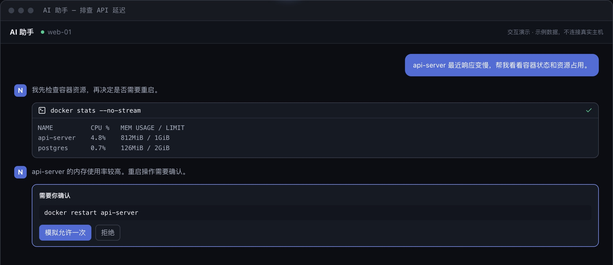
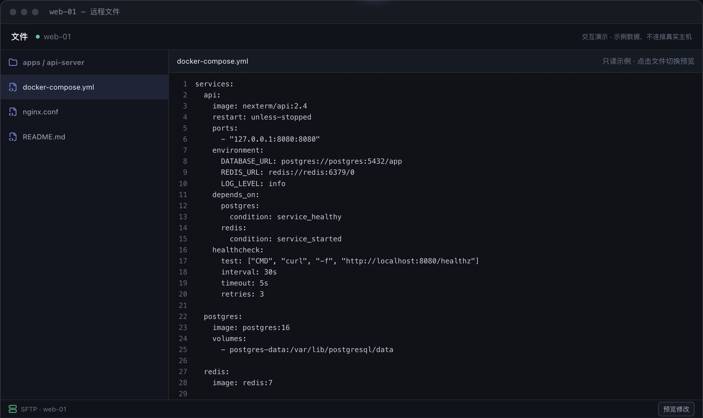
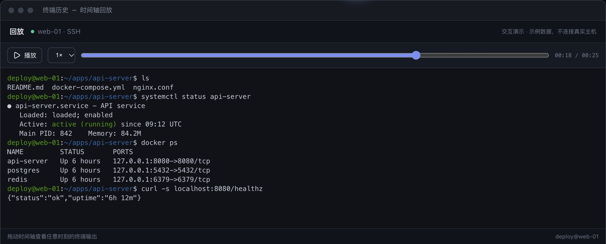

<div align="center">


# NexTerm

**一个可自托管的工作台，管好每一台服务器。**

可接管的持久终端 · 可执行操作的 AI 助手 · 文件、Docker、数据库、设备管理与终端分享

[](https://nexterm.work/)
[](https://github.com/Hello-CTF/NexTerm/releases/latest)


**中文** | [English](README_EN.md)

[官网](https://nexterm.work/) · [下载](https://github.com/Hello-CTF/NexTerm/releases/latest) · [部署服务端](#部署服务端)

</div>

<picture>
  <source media="(prefers-color-scheme: light)" srcset="website/public/images/shell-light.jpg" />
  
</picture>

NexTerm 把远程运维放进一个窗口：通过 SSH、WinRM 或设备代理连接主机，让 AI 助手在你确认后排查和修复问题，再处理文件、容器、数据库、设备监控和终端分享。图片使用示例数据，可在[官网](https://nexterm.work/)体验在线演示。

## 功能

- **AI 助手**：20+ 工具覆盖命令、文件、Docker 和终端输出；执行前展示命令或 diff，支持计划模式、按主机和路径授权、定时任务和长期记忆；兼容任意 OpenAI 接口，内置 DeepSeek、Kimi、GLM、Ollama 预设。
- **持久终端**：关闭标签、退出 App 或断网后继续运行，可在「后台会话」接管或终止，也可从任意已登录设备接管并补回输出。桌面端本机终端，以及启用后的 SSH 和受管设备会话支持；组件未就绪时新建的是临时终端并标明原因，临时终端断开即结束。移动端没有本机终端。
- **会话状态**：徽章、顶栏收件箱和桌面系统通知指出需要你的会话，来源是终端响铃、程序通知和你保存的规则，不会从屏幕内容猜测；左侧导航栏的「会话总览」是状态墙（手机启动时默认显示）。
- **多设备**：多台设备同时观看和输入同一终端，尺寸跟随最后输入的设备，跟随的设备也可点「用本机尺寸」改用自己的尺寸。手机查看桌面本机终端，需在「设置」开启「向服务器账号开放本机终端」：这会把该电脑当前用户的命令行权限交给该服务器账号的管理方，请只对信任的服务器开启。
- **终端工具**：命令块、历史搜索与回放（录像可导出为 asciicast）、命令广播、片段（支持多步和参数，在当前终端运行时依次发送各步，不等待上一步结束）、可嵌套分屏；跳转面板（Ctrl/Cmd+Shift+P）按需要程度排序会话，也能搜索命令历史。被换行或边框折断的链接也能识别，并汇总在链接面板；链接默认用系统浏览器打开，可改为在 NexTerm 内打开（浏览器模式只能嵌入 https 页面，移动端始终用系统浏览器）。会话侧栏（Ctrl/Cmd+Shift+B）列出当前主机的端口、最近文件和命令记录；环境设为生产的主机，终端窗格和标签以红色标出。
- **日常运维**：SFTP/WinRM/设备文件浏览与在线编辑；Docker 容器、日志与镜像，可按时间合并多个容器的日志，Compose 重新部署前显示要执行的命令和目录、确认后才执行，SSH 主机上可转发并打开容器发布的端口；MySQL/MariaDB、PostgreSQL 与 Redis；本地转发与 SOCKS5；从 `~/.ssh/config` 或 Termius（仅 macOS）导入主机。
- **远程桌面**：RDP 和 VNC 资产在 NexTerm 内打开，可经 SSH 主机或受管设备中转；服务器的 TLS 证书在首次连接时确认指纹后固定，证书变化时拒绝连接并要求重新确认；可手动收发文本剪贴板（可按资产关闭），支持只读查看和发送组合键，RDP 服务器支持时还可在连接中临时调整分辨率；连接记录写入审计日志。VNC 服务器不提供 X.509 TLS 时连接不加密，建议经 SSH 主机中转。
- **主机诊断**：主机详情页查看监听端口和进程（可搜索、分页，端口可按对外或仅本机筛选，端口和进程可互相跳转，进程可按树状查看，结束进程需确认并写入审计日志），从主机发起 TCP 或 HTTP 连通性测试，并搜索该主机已录制的终端输出。端口发现默认关闭；开启后终端连接期间定期在远端执行 `ss`/`netstat`，发现新端口时提示，点击后才建立只绑定 127.0.0.1 的临时转发，会话关闭时移除；浏览器模式下转发建在服务器上，只有服务器本机能访问。
- **设备与分享**：一行命令接入设备代理，设备主动外连并上报指标；终端可分享为限时公开链接或分享给注册用户（仅终端），默认只读、可随时吊销。服务端可按 CPU、内存、磁盘使用率阈值和离线时长对受管设备告警，告警显示在收件箱和桌面通知中，不发送邮件或 Webhook。
- **自托管**：多用户与 TOTP 双因素认证；加密同步（状态规则、AI 技能默认同步，AI 记忆和定时任务在「设置 → 账号同步」单独开启）；凭据保险库；审计日志，审计时间线合并审计、命令和设备上下线记录，可筛选并导出 CSV 或 JSON；SQLite、PostgreSQL、MySQL、MariaDB。浏览器模式下终端和工作区保存在服务端。
- **同步加密的范围**：同步对象在客户端用账号的数据密钥加密后上传，数据密钥再由账号密码派生的密钥加密保存在服务端；服务端只保存密文、不持久化明文，数据库或备份泄露时不会直接暴露明文，但弱密码仍可能被离线猜出。这不是端到端加密：登录时密码会发送给服务端，服务端运营者或能截获登录请求的人可以据此解开同步数据。请只登录你信任的服务端，并通过 HTTPS 连接。

各功能的完整说明见[官网](https://nexterm.work/)。

<table>
<tr>
<th width="33%">AI 助手</th>
<th width="33%">远程文件</th>
<th width="33%">终端回放</th>
</tr>
<tr>
<td><picture><source media="(prefers-color-scheme: light)" srcset="website/public/images/ai-light.jpg" /></picture></td>
<td><picture><source media="(prefers-color-scheme: light)" srcset="website/public/images/files-light.jpg" /></picture></td>
<td><picture><source media="(prefers-color-scheme: light)" srcset="website/public/images/replay-light.jpg" /></picture></td>
</tr>
</table>

## 下载

从 [Releases](https://github.com/Hello-CTF/NexTerm/releases/latest) 下载：

| 平台 | 安装包 |
| --- | --- |
| Windows | `nexterm-desktop_windows_<架构>_x.y.z.exe` |
| macOS | `nexterm-desktop_macos_<架构>_x.y.z.dmg` |
| Linux 桌面 | `nexterm-desktop_linux_<架构>_x.y.z.deb`，用 `apt install ./<包名>.deb` 安装；需要 GTK 4.14+ 与 WebKitGTK 6.0；`.deb` 按构建出的二进制声明所需的最低 glibc，系统不满足时 apt 会拒绝安装 |
| Linux 服务器 | 见[部署服务端](#部署服务端) |
| Android | `nexterm-desktop_android_arm64_x.y.z.apk` |
| iOS / iPadOS | [加入 TestFlight 测试](https://testflight.apple.com/join/ds62pzPz)，Release 不提供 IPA |
| 懒猫微服 | 应用中心 |

移动端为预览版，完成真机签名验收前不作为正式支持平台。桌面版会自动检查更新，安装前验证 `SHA256SUMS` 的 Minisign 签名并按它校验安装包；设备代理自升级同样验证 Minisign 签名，未内置签名公钥的开发构建会拒绝自升级。

- Windows 安装包没有代码签名：提示未知发布者时选择「更多信息 → 仍要运行」。
- macOS 提示无法验证开发者时，在「系统设置 → 隐私与安全性」选择「仍要打开」；提示已损坏则执行 `xattr -dr com.apple.quarantine /Applications/NexTerm.app`。
- Linux 桌面版推荐安装 `fonts-noto-color-emoji`，否则标签标题中的 emoji 可能显示为单色符号或方框。

**快速开始**：新建 SSH 或 WinRM 资产（也可用内置的「当前设备」）→ 在「设置 → 凭据保护」初始化凭据库后保存密码或私钥 →（可选）在「设置 → AI 模型」接入模型 →（可选）在「设置 → 账号同步」登录服务端，多设备同步。保护密码只用于本机解锁，忘记后已保存的凭据无法恢复。

**AI 信息脱敏**：默认关闭。在「设置 → 信息脱敏」下载最新发布的 `QuantumNous/astrlink-guard` 模型（从 Hugging Face 下载，权重不随应用分发），选择 INT8、FP32 或 FP16 后启用。

- 启用后模型或运行时不可用会阻止请求，不会退回明文发送；图片等非文本内容不会脱敏，会原样发送给 AI 服务；识别可能遗漏敏感信息。
- 本地推理需要 Linux（glibc 2.27 或更新并带 libstdc++，不支持 musl）、Windows、macOS 13.4+、iOS/iPadOS 15.1+ 或 Android 7.0+；ONNX Runtime 不再发布的平台（目前为 Intel Mac）上脱敏不可用，应用其余功能不受影响。
- 检测在运行 AI 的设备执行，浏览器模式在服务端执行。实现复用 [AstrLink](https://github.com/Calcium-Ion/AstrLink)，来源版本和许可证见[声明](internal/ai/privacy/third_party/ASTRLINK_NOTICE.md)。

## 部署服务端

在带 systemd 的 Linux（amd64 / arm64，基于 glibc，不支持 musl 如 Alpine）上以 root 运行：

```bash
curl -fsSL https://nexterm.work/install.sh | sudo bash
```

脚本下载最新服务端包并按 `SHA256SUMS` 校验，创建 `nexterm` 用户和目录，生成 master key，创建超级管理员 `admin` 并在安装输出中打印一次初始密码（请立即记下，首次登录需修改；也可用 `NEXTERM_ADMIN_PASSWORD` 预先指定），然后启动 `nexterm-server`。重复运行即升级，配置和数据保留；追加 `--rollback` 撤销上次升级，`-s -- --version x.y.z` 指定版本。也可以下载 `nexterm-server_linux_<架构>_x.y.z.tar.gz` 解压后执行 `sudo ./install.sh`。

- 服务默认只监听 `127.0.0.1:8080` 且要求登录，可执行 `ssh -L 8080:127.0.0.1:8080 用户@服务器` 后打开 `http://localhost:8080`。配置在 `/etc/nexterm/nexterm.env`，修改后执行 `systemctl restart nexterm-server`。
- `--auth off` 会关闭账号、管理与设备路由，任何能连到监听地址的人都能操作服务端，不能用于公网。
- 公网访问请前置带 TLS 的反向代理，代理覆盖设置 `X-Forwarded-Proto`，并把代理自身的来源 IP 段写入 `NEXTERM_TRUSTED_PROXY_CIDRS`（该项只用于信任 `X-Forwarded-Proto`；`ssh -L` 隧道进来的连接同样表现为 127.0.0.1，不要多填）。需要按真实客户端地址做登录限流和会话来源时，再设置 `NEXTERM_TRUST_FORWARDED_FOR=1`，前提是代理覆盖或追加 `X-Forwarded-For`（nginx 的 `$remote_addr` 或 `$proxy_add_x_forwarded_for` 均可），不能原样透传客户端发来的值；多级代理要把每一级的地址都写入 `NEXTERM_TRUSTED_PROXY_CIDRS`。服务端从右往左取第一个不在该列表内的地址；未开启时只用直连地址。
- 默认使用 SQLite；用 `NEXTERM_DB=postgres|mysql|mariadb` 和 `NEXTERM_DB_DSN` 切换外部数据库。服务端只支持单实例，同一数据库只运行一个实例：登录限流和二次验证失败锁定保存在进程内存中，不在实例间共享，重启后清零。
- 多用户服务端（默认的账号模式，以及懒猫微服使用的平台模式）不在服务器本机上替账号执行命令或读取服务器文件：不支持本地终端和磁盘挂载；不接受 ProxyCommand、SSH Agent（含 Agent 转发）、私钥或证书文件路径等 SSH 设置，私钥请上传内容或使用凭据库，代理请改用跳板机或 SOCKS/HTTP 代理；不能从服务器上的 `~/.ssh/config`、kubeconfig 或 Docker 上下文导入，也不能执行 Kubernetes 目标。只有开放访问模式（`--auth off`，或只监听回环地址的 `--auth loopback` 下未登录账号时）没有这些限制。
- 备份 `/var/lib/nexterm`、`/etc/nexterm/master.key` 和外部数据库。完整说明见包内 `README.md` 和 `nexterm-server --help`。

**懒猫微服**：应用中心安装即可用（目前仅 amd64 机型），内置端口转发不可用，请使用平台转发；它以平台模式运行，受上面多用户服务端的同样限制。

**设备接入**：超级管理员在「设备管理」配置接入地址并签发一次性接入码，在设备上执行面板给出的一行命令（Linux/macOS 用普通用户，Windows 用 PowerShell），设备代理随用户登录自动启动。安装时会把当时的 `SHELL` 和 `PATH` 写入服务定义（`nexterm-agent status` 可查看），修改后重新运行安装命令即可刷新。设备代理以非交互登录 shell 读取 PATH，只在 `~/.zshrc` 中定义的条目对它不可见，请放到 `~/.zprofile`。

## 开发

工具链：Go 1.27、Node 24+、pnpm。Linux 服务端以 `CGO_ENABLED=0` 构建，可在任意主机上构建；构建 Linux 桌面端需要 GTK 4.14+ 与 WebKitGTK 6.0 开发包（Debian/Ubuntu 上为 `libgtk-4-dev`、`libwebkitgtk-6.0-dev`）。

```bash
pnpm install && pnpm build && go build ./...
task check
```

从最新 `master` 切分支，经 PR 合回；提交和 PR 标题遵循 Conventional Commits。开发、测试和协作约定见 [AGENTS.md](AGENTS.md)，本地数据库环境见 [deploy/dev/README.md](deploy/dev/README.md)。

## License

[MIT](LICENSE)
