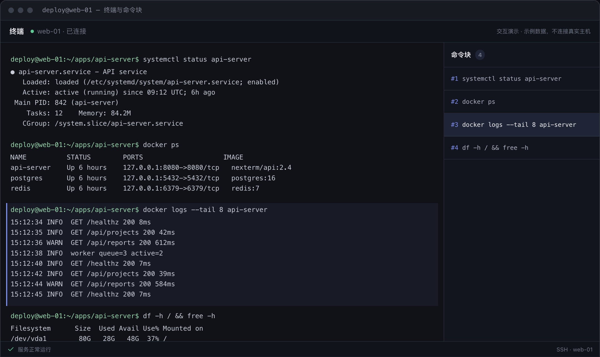
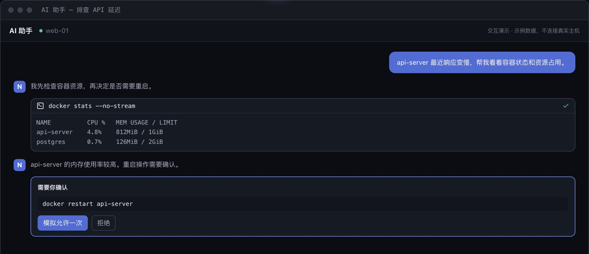
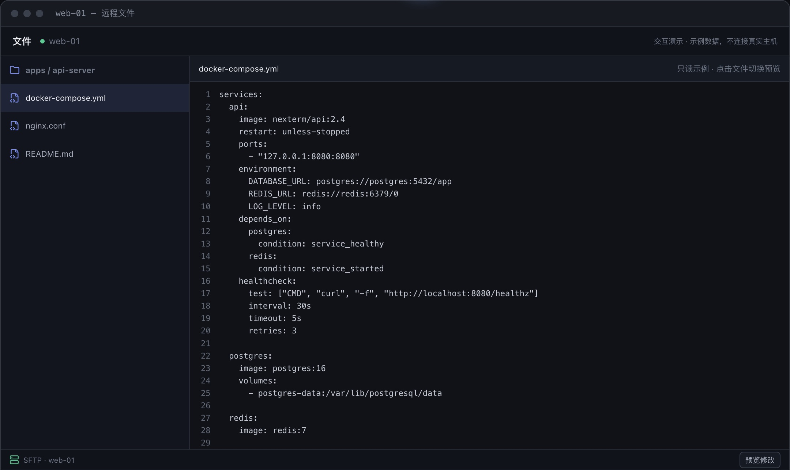
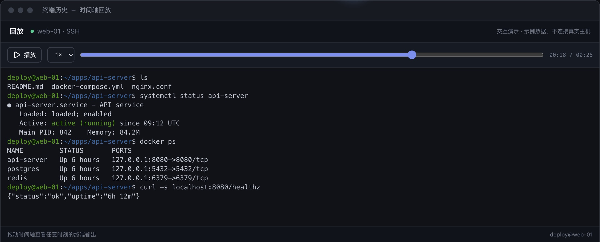

<div align="center">


# NexTerm

**One self-hostable workbench for every server you run.**

Persistent, re-attachable terminals · an AI assistant that actually does the work · files, Docker, databases, device fleet, and sharing

[](https://nexterm.work/)
[](https://github.com/Hello-CTF/NexTerm/releases/latest)


**English** | [中文](README.md)

[Website](https://nexterm.work/) · [Download](https://github.com/Hello-CTF/NexTerm/releases/latest) · [Deploy the server](#deploy-the-server)

</div>

<picture>
  <source media="(prefers-color-scheme: light)" srcset="website/public/images/shell-light.jpg" />
  
</picture>

NexTerm puts remote operations in one window: connect over SSH, WinRM, or the device agent, let the AI assistant diagnose and fix issues after you confirm, then work with files, containers, databases, device monitoring, and terminal sharing. The images use sample data; try the live demos on the [website](https://nexterm.work/).

## Features

- **AI assistant**: 20+ tools for commands, files, Docker, and terminal output; commands and diffs are shown before they run, with plan mode, per-host and per-path grants, scheduled tasks, and long-term memory. Works with any OpenAI-compatible API, with DeepSeek, Kimi, GLM, and Ollama presets.
- **Persistent terminals**: they keep running after you close the tab, quit the app, or lose the network, can be taken over or ended from Background sessions, and can be re-attached from any signed-in device with missed output replayed. Supported for desktop local terminals and, once enabled, SSH and managed-device sessions; a terminal opened while the helper is not ready is a temporary terminal with the reason shown, and a temporary terminal ends on disconnect. Mobile has no local terminals.
- **Session status**: badges, the header inbox, and desktop notifications point at the sessions that need you, based on terminal bells, program notifications, and rules you save; NexTerm does not guess from the screen. The rail's session overview is a status wall (shown at launch on mobile).
- **Many devices**: several devices can watch and type into one terminal at once, and the size follows the last device that typed. To see a desktop's local terminals from a phone, turn on "Expose local terminals to the server account" in Settings: this hands that computer's command line, as the current user, to the server account's administrators, so enable it only for a server you trust.
- **Terminal tools**: command blocks, searchable history and replay (recordings export as asciicast), broadcast, snippets (multi-step with parameters; in the current terminal the steps are sent in turn without waiting for the previous one to finish), nestable splits, and a jump palette (Ctrl/Cmd+Shift+P) that ranks sessions by how much they need you and also searches command history. Links broken across lines or box borders are still detected and collected in a link panel; links open in the system browser by default, or inside NexTerm if you choose (browser mode can only embed https pages, and mobile always uses the system browser). The session sidebar (Ctrl/Cmd+Shift+B) lists the current host's ports, recent files, and commands; terminals and tabs of hosts whose environment is marked production are outlined in red.
- **Everyday operations**: SFTP, WinRM, and device file browsing with in-place editing; Docker containers, logs, and images, with logs of several containers merged by time, Compose redeploys that show the exact command and directory and run only after you confirm, and forwarding and opening of published container ports on SSH hosts; MySQL/MariaDB, PostgreSQL, and Redis; local forwarding and SOCKS5; host import from `~/.ssh/config` or Termius (macOS only).
- **Remote desktop**: RDP and VNC assets open inside NexTerm, directly or through an SSH host or managed device. A server's TLS certificate is pinned after you confirm its fingerprint on first connect, and a changed certificate is refused until you confirm it again. Text clipboard can be sent and fetched by hand (and turned off per asset), and read-only viewing and key combinations are supported; RDP can change the resolution during a connection when the server allows it, and connections are recorded in the audit log. A VNC connection is unencrypted when the server offers no X.509 TLS, so route it through an SSH host.
- **Host diagnostics**: host details list listening ports and processes (searchable, with a tree view; ending a process asks first and is audited), run TCP or HTTP connectivity tests from the host, and search the host's recorded terminal output. Port discovery is off by default; when on, it runs `ss`/`netstat` on the remote host periodically while a terminal is connected, points out new ports, and only on your click creates a temporary forward bound to 127.0.0.1 that is removed with the session; in browser mode the forward lives on the server and only the server machine can reach it.
- **Devices and sharing**: enroll the device agent with one command; devices connect outward and report metrics. Share a terminal as a time-limited public link or with registered users (terminal only), read-only by default and revocable. The server can alert on managed devices by CPU, memory, and disk usage thresholds and by time offline; alerts show in the inbox and desktop notifications, and no email or webhook is sent.
- **Self-hosted**: multi-user accounts with TOTP; encrypted sync (state rules and AI skills sync by default; AI memory and scheduled jobs are separate opt-ins under Settings → Account sync); a credential vault; audit logs, with an audit timeline that merges audit, command, and device online/offline records and can be filtered and exported as CSV or JSON; SQLite, PostgreSQL, MySQL, or MariaDB. In browser mode, terminals and workspaces live on the server.
- **What sync encryption covers**: sync objects are encrypted on the client with the account's data key before upload, and the data key is stored on the server wrapped by a key derived from the account password. The server stores only ciphertext and never persists plaintext, so a leaked database or backup does not expose plaintext directly, though a weak password can still be guessed offline. This is not end-to-end encryption: the password is sent to the server at sign-in, so the server operator, or anyone who can intercept a sign-in request, can use it to decrypt the synced data. Sign in only to servers you trust, over HTTPS.

The website describes each feature in full: [nexterm.work](https://nexterm.work/).

<table>
<tr>
<th width="33%">AI assistant</th>
<th width="33%">Remote files</th>
<th width="33%">Terminal replay</th>
</tr>
<tr>
<td><picture><source media="(prefers-color-scheme: light)" srcset="website/public/images/ai-light.jpg" /></picture></td>
<td><picture><source media="(prefers-color-scheme: light)" srcset="website/public/images/files-light.jpg" /></picture></td>
<td><picture><source media="(prefers-color-scheme: light)" srcset="website/public/images/replay-light.jpg" /></picture></td>
</tr>
</table>

## Download

Get the latest build from [Releases](https://github.com/Hello-CTF/NexTerm/releases/latest):

| Platform | Package |
| --- | --- |
| Windows 10/11 (amd64 / arm64) | `nexterm-desktop_windows_<arch>_x.y.z.exe` |
| macOS (arm64 / amd64) | `nexterm-desktop_macos_<arch>_x.y.z.dmg` |
| Linux desktop (amd64 / arm64) | `nexterm-desktop_linux_<arch>_x.y.z.deb`, install with `apt install ./<package>.deb`; needs GTK 4.14+ and WebKitGTK 6.0; the `.deb` declares the minimum glibc its binary requires, so apt refuses older systems |
| Linux server | See [Deploy the server](#deploy-the-server) |
| Android (preview, arm64) | `nexterm-desktop_android_arm64_x.y.z.apk` |
| iOS / iPadOS (preview) | [Join the TestFlight beta](https://testflight.apple.com/join/ds62pzPz); releases do not ship an IPA |
| LazyCat MicroServer (amd64) | App Store |

Mobile builds are previews and are not officially supported until real-device signing is verified. The desktop app checks for updates automatically, verifies the Minisign signature of `SHA256SUMS`, and checks the installer against it. The device agent's self-upgrade verifies the Minisign signature too, and development builds without an embedded signing key refuse to self-upgrade.

- Windows installers are not code-signed: if Windows reports an unknown publisher, choose "More info → Run anyway".
- If macOS cannot verify the developer, choose "Open Anyway" in System Settings → Privacy & Security; if it reports the app is damaged, run `xattr -dr com.apple.quarantine /Applications/NexTerm.app`.
- On the Linux desktop, install `fonts-noto-color-emoji`, or emoji in tab titles may show as monochrome symbols or boxes.

**Quick start**: add an SSH or WinRM asset (or use the built-in "This device") → initialize the vault in Settings → Credential protection before saving passwords or keys → optionally add a model in Settings → AI models → optionally sign in under Settings → Account sync to sync across devices. The protection password only unlocks this device; if you forget it, saved credentials cannot be recovered.

**AI privacy redaction**: off by default. Download the latest released `QuantumNous/astrlink-guard` model in Settings → 信息脱敏 (downloaded from Hugging Face; weights are not bundled), select INT8, FP32, or FP16, then enable it.

- When enabled, an unavailable model or runtime blocks requests instead of sending plaintext; images and other non-text content are not redacted and go to the AI provider unchanged; detection can miss sensitive information.
- Local inference needs Linux (glibc 2.27 or newer with libstdc++; musl is not supported), Windows, macOS 13.4+, iOS/iPadOS 15.1+, or Android 7.0+. Redaction is unavailable on platforms ONNX Runtime no longer publishes (currently Intel Macs); the rest of the app works.
- Detection runs on the device running AI, or on the server in browser mode. The implementation reuses [AstrLink](https://github.com/Calcium-Ion/AstrLink); see the [source and license notice](internal/ai/privacy/third_party/ASTRLINK_NOTICE.md).

## Deploy the server

On Linux with systemd (amd64 / arm64, glibc-based; musl distributions such as Alpine are not supported), run as root:

```bash
curl -fsSL https://nexterm.work/install.sh | sudo bash
```

The script downloads the latest server archive and verifies it against `SHA256SUMS`, creates the `nexterm` user and directories, generates the master key, creates the `admin` super-admin and prints its initial password once in the installer output (write it down; it must be changed at first login, or preset it with `NEXTERM_ADMIN_PASSWORD`), then starts `nexterm-server`. Running it again upgrades in place and keeps configuration and data; add `--rollback` to undo the last upgrade, or `-s -- --version x.y.z` to pin a version. You can also download `nexterm-server_linux_<arch>_x.y.z.tar.gz`, extract it, and run `sudo ./install.sh`.

- The service listens on `127.0.0.1:8080` and requires sign-in by default; run `ssh -L 8080:127.0.0.1:8080 user@server` and open `http://localhost:8080`. Settings live in `/etc/nexterm/nexterm.env`; run `systemctl restart nexterm-server` after changing them.
- `--auth off` disables accounts, administration and device routes; anyone who can reach the listen address can operate the server, so never use it on a public network.
- For public access, put a TLS reverse proxy in front, have it overwrite `X-Forwarded-Proto`, and list only the proxy's own addresses in `NEXTERM_TRUSTED_PROXY_CIDRS` (it only trusts `X-Forwarded-Proto`; connections arriving through an `ssh -L` tunnel also look like 127.0.0.1). To rate-limit logins and record session origins by the real client address, also set `NEXTERM_TRUST_FORWARDED_FOR=1`, provided the proxy overwrites or appends to `X-Forwarded-For` (nginx `$remote_addr` or `$proxy_add_x_forwarded_for` both work) and never passes the client-supplied value through unchanged; with chained proxies, list every hop in `NEXTERM_TRUSTED_PROXY_CIDRS`. The server takes the rightmost address that is not in that list. Without it only the direct peer address is used.
- SQLite is the default; use `NEXTERM_DB=postgres|mysql|mariadb` with `NEXTERM_DB_DSN` for an external database. The server runs as a single instance, one per database: login rate limits and second-factor lockouts are held in process memory, are not shared between instances, and reset on restart.
- A multi-user server (the default account mode, and the platform mode LazyCat uses) does not run commands on the server machine or read its files on an account's behalf: local terminals and disk mounts are unavailable; SSH settings such as ProxyCommand, SSH agent use (including agent forwarding), and private key or certificate file paths are refused, so upload key contents or use the vault, and use a jump host or SOCKS/HTTP proxy instead; imports from the server's `~/.ssh/config`, kubeconfig, or Docker contexts and Kubernetes target exec are unavailable. Only open access lifts these limits: `--auth off`, or `--auth loopback` listening on loopback when no account is signed in.
- Back up `/var/lib/nexterm`, `/etc/nexterm/master.key`, and any external database. See the bundled `README.md` and `nexterm-server --help` for every option.

**LazyCat MicroServer**: install from the App Store (amd64 devices only for now); built-in port forwarding is unavailable, so use the platform's forwarding. It runs in platform mode and has the same multi-user server limits as above.

**Device enrollment**: a super-admin sets the enrollment address in Devices and issues a one-time enrollment code; run the one-line command shown there on the device (as a regular user on Linux/macOS, in PowerShell on Windows). The agent starts automatically at user login. Install records the then-current `SHELL` and `PATH` in the service definition (`nexterm-agent status` shows them; re-run the install command to refresh). The agent reads PATH through a non-interactive login shell, so entries defined only in `~/.zshrc` are not visible to it: put them in `~/.zprofile`.

## Development

Toolchain: Go 1.27, Node 24+, pnpm. The Linux server is a `CGO_ENABLED=0` build that can be produced on any host; building the Linux desktop needs the GTK 4.14+ and WebKitGTK 6.0 development packages (`libgtk-4-dev` and `libwebkitgtk-6.0-dev` on Debian and Ubuntu).

```bash
pnpm install && pnpm build && go build ./...
task check
```

Branch from the latest `master` and merge back through a PR; commits and PR titles follow Conventional Commits. See [AGENTS.md](AGENTS.md) for development, testing, and collaboration rules, and [deploy/dev/README.md](deploy/dev/README.md) for the local database environment.

## License

[MIT](LICENSE)
