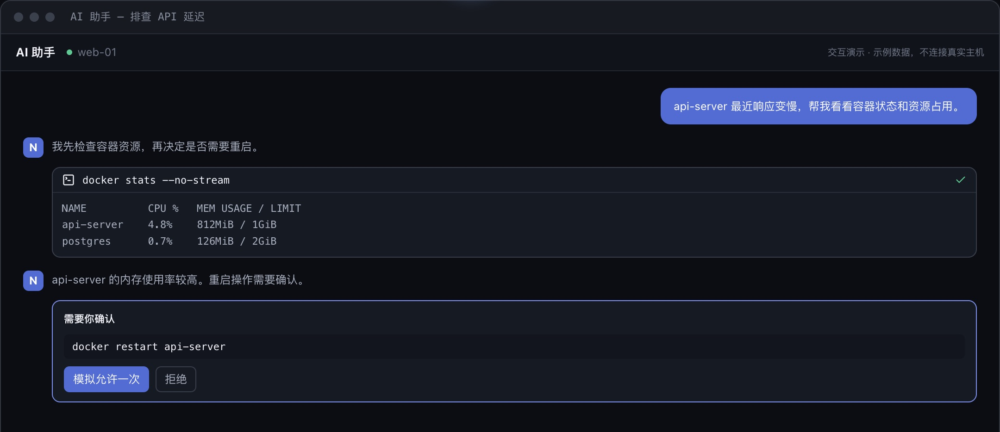
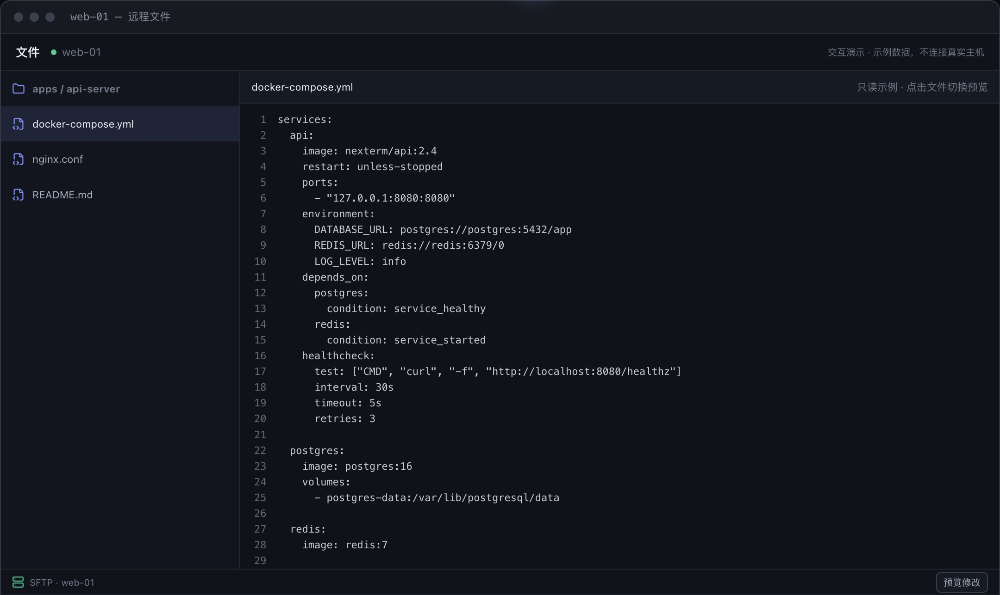
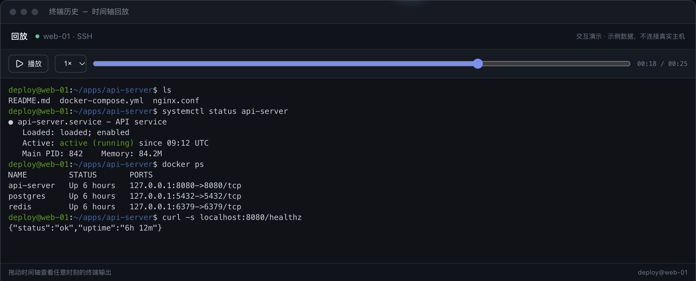

# Features

**English** | [中文](features.md) · [Back to README](../README_EN.md)

The images use sample data; try the live demos on the [website](https://nexterm.work/). The app UI is in Chinese; Chinese labels are shown in parentheses. Mobile (Android, iOS, iPadOS) is a preview and has no local terminals.

## Terminals

- **Persistent terminals**: they keep running after you close the tab, quit the app, or lose the network, can be taken over or ended from Background sessions (后台会话), and can be re-attached from any signed-in device with missed output replayed. Supported for desktop local terminals and, once enabled, SSH and managed-device sessions; a terminal opened while the persistent terminal helper is not ready is a temporary terminal with the reason shown, and a temporary terminal ends on disconnect.
- **Telnet**: Telnet assets (default port 23) for switches, routers, and other legacy gear offer only a terminal, which is a temporary terminal, and cannot connect through a jump host yet. Telnet is unencrypted, so credentials and terminal content travel as plain text; use it only on trusted networks.
- **Session status**: badges, the header inbox, and system notifications point at the sessions that need you, based on terminal bells, program notifications, and rules you save (never guessed from the screen); the session overview (会话总览) is a status wall, and OSC 9;4 progress shows as a ring.
- **Many devices**: several devices can watch and type into one terminal at once. To see a desktop's local terminals from a phone, turn on "Expose local terminals to the server account" (向服务器账号开放本机终端) in Settings: this hands that computer's command line, as the current user, to the server account's administrators, so enable it only for a server you trust.
- **Terminal tools**: command blocks with one-click AI explanation of errors, searchable history and replay (export as asciicast or plain text), broadcast, multi-step snippets, nestable splits and layout templates, a jump palette (Ctrl/Cmd+Shift+P), link and file path detection, quick select, copy mode, and a session sidebar (ports, recent files, commands, and an optional host monitor that is off by default); production hosts are outlined in red.
- **Keyword highlighting and appearance**: highlight output by text or regex under Settings → Terminal (off by default), pick dark and light color schemes, and import iTerm2, Windows Terminal, and Ghostty/kitty themes; rules and schemes sync with the account.
- **In-terminal file transfer**: [trzsz](https://trzsz.github.io/) is supported (`trz` to upload, `tsz` to download); every transfer is confirmed on this device first and never replaces existing files. ZMODEM is not supported. Turn it off under Settings → Terminal → File transfer (文件传输).
- **Local shells**: a local asset can use a detected shell or a path with start arguments; multi-user servers do not offer local assets.
- **Lock screen**: "Lock NexTerm" (锁定 NexTerm) hides the interface and blocks input while terminals keep running, with optional idle auto-lock. It keeps passers-by away while you are gone; it does not replace the operating system lock screen.

## AI assistant

20+ tools for commands, files, Docker, and terminal output; writes show the command or diff before they run, with plan mode, per-host and per-path grants, scheduled tasks, and long-term memory. Permission modes are read-only, read-write, auto-run and full access (runs everything except forbidden operations; interception-rule hits still ask, production hosts are treated as auto-run, and scheduled tasks never use it). The maximum steps per answer is adjustable in settings (default 999); reaching it pauses the answer with a Continue option. Works with any OpenAI-compatible API, with DeepSeek, Kimi, GLM, and Ollama presets. In a terminal, press Ctrl+Shift+G (Cmd+I on macOS) to generate a command from plain words; it is typed at the prompt and never run automatically, and production hosts ask again first. For optional local redaction, see [AI privacy redaction](security.en.md#ai-privacy-redaction).

## Everyday operations

- **Files, containers, and databases**: SFTP, WinRM, and device file browsing with in-place editing; Docker containers, logs, images, and Compose (the command is shown before a redeploy); MySQL/MariaDB, PostgreSQL, and Redis; local forwarding and SOCKS5.
- **Host import**: from `~/.ssh/config` and Termius (macOS only), and on desktop the SSH sessions of PuTTY, MobaXterm, Xshell, and SecureCRT; a preview shows conflicts first, and passwords and `.ppk` keys are not imported.
- **Remote desktop**: RDP and VNC open inside NexTerm, directly or through an SSH host or managed device, with TLS certificates pinned after you confirm the fingerprint once. A VNC connection is unencrypted when the server offers no X.509 TLS, so route it through an SSH host.
- **Host diagnostics**: host details show listening ports and processes, run TCP or HTTP connectivity tests, and search the host's recorded terminal output; ending a process asks first and is audited. Port discovery is off by default.
- **Host services and logs**: manage Linux systemd and Windows services (write actions use the production confirmation and audit log), and follow journalctl, files, Docker containers, and Windows event logs across hosts.

## Devices, sharing, and self-hosting

- **Devices and sharing**: enroll the device agent with one command (see [Device enrollment](device-agent.en.md)); share a terminal as a time-limited public link or with registered users, read-only by default and revocable; managed devices can alert on CPU, memory, and disk thresholds and time offline, shown only in the inbox and desktop notifications, with no email or webhook.
- **Self-hosted**: multi-user accounts with TOTP, a credential vault, audit logs and a timeline (exportable as CSV or JSON), and SQLite, PostgreSQL, MySQL, or MariaDB; an HTTP, SOCKS4, or SOCKS5 proxy can be set when signing in to a server. In browser mode, terminals and workspaces live on the server.
- **Encrypted sync**: state rules and AI skills sync by default; AI memory and scheduled jobs are separate opt-ins under Settings → Account and sync (账号与同步). Sync is not end-to-end encrypted; see [Security](security.en.md) for the scope.

## Screenshots

| AI assistant | Remote files | Terminal replay |
| --- | --- | --- |
|  |  |  |
