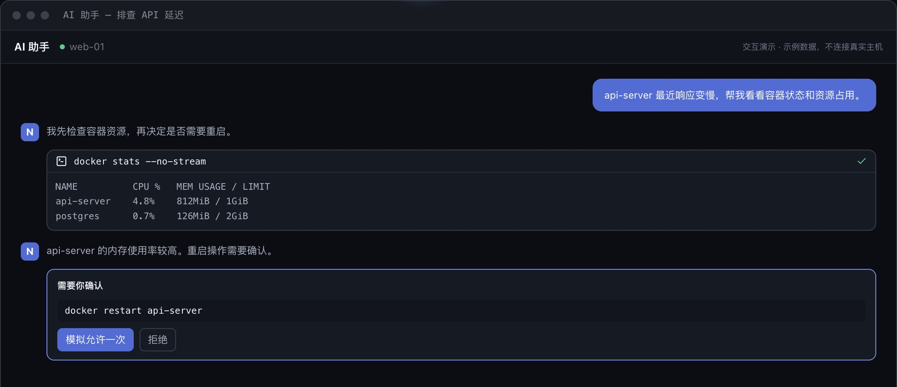
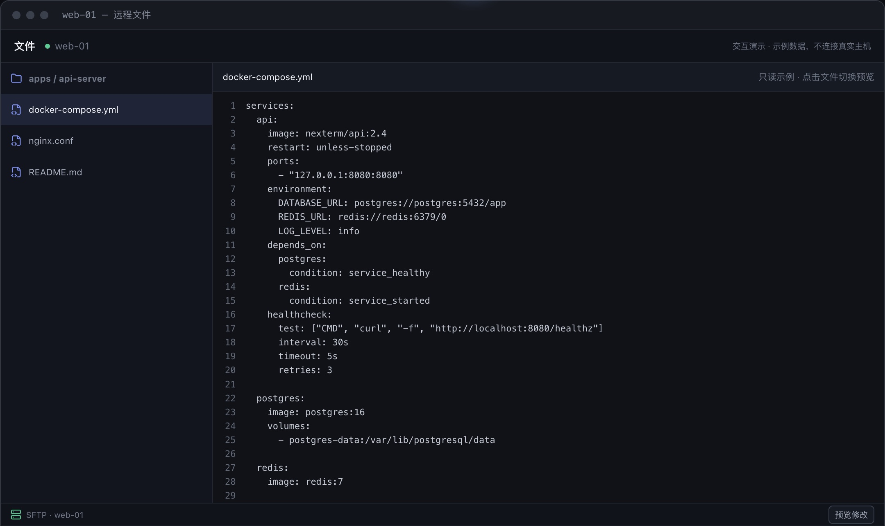
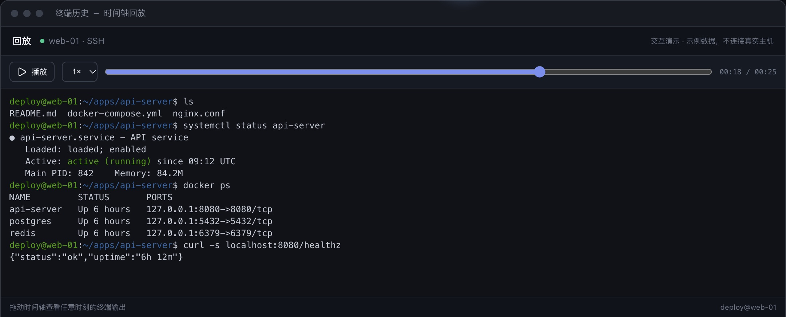

# Features

**English** | [中文](features.md) · [Back to README](../README_EN.md)

The images use sample data; try the live demos on the [website](https://nexterm.work/). The app UI is in Chinese; Chinese labels are shown in parentheses.

## Terminals

- **Persistent terminals**: they keep running after you close the tab, quit the app, or lose the network, can be taken over or ended from Background sessions (后台会话), and can be re-attached from any signed-in device with missed output replayed. Supported for desktop local terminals and, once enabled, SSH and managed-device sessions; a terminal opened while the persistent terminal helper is not ready is a temporary terminal with the reason shown, and a temporary terminal ends on disconnect. WinRM non-interactive terminals end when closed. Mobile has no local terminals.
- **Session status**: badges, the header inbox, and desktop notifications point at the sessions that need you, based on terminal bells, program notifications, and rules you save; NexTerm does not guess from the screen. The rail's session overview (会话总览) is a status wall (shown at launch on mobile). Progress that a program reports with OSC 9;4 (the progress sequence of Windows Terminal, ConEmu and Ghostty) shows as a ring on its tab and in the jump palette; it is tracked while the persistent terminal runs in the background and shown on re-attach; it clears when the command ends, a new command starts, or no report arrives for 15 seconds. A progress error counts as needing you and follows the needs-me notification setting. The desktop taskbar does not show progress.
- **Many devices**: several devices can watch and type into one terminal at once, and the size follows the last device that typed; a following device can also choose "Use this device's size" (用本机尺寸). To see a desktop's local terminals from a phone, turn on "Expose local terminals to the server account" (向服务器账号开放本机终端) in Settings: this hands that computer's command line, as the current user, to the server account's administrators, so enable it only for a server you trust.
- **Terminal tools**: command blocks (marks colored by exit status; the command stays pinned at the top once its line scrolls away; Ctrl/Cmd+Shift+Up/Down jumps between commands and Ctrl/Cmd+Shift+O selects and copies the last command's output (while a full-screen program such as vim or less runs, these keys go to it as usual); a non-zero exit reported by the shell offers a one-click AI explanation), searchable history and replay (recordings export as asciicast, or as plain text as it appeared in the terminal with optional per-line timestamps), broadcast, snippets (multi-step with parameters; in the current terminal the steps are sent in turn, and a step can wait for text or a regex to appear in the terminal output before it is sent, stopping with a notice on timeout or cancel), nestable splits, and a jump palette (Ctrl/Cmd+Shift+P) that ranks sessions by how much they need you and also searches command history (each command shows the directory it started in, a toggle keeps only commands from the current terminal's directory, and commands from that directory rank slightly higher; directories come from the shell's OSC 7 reports). Links broken across lines or box borders are still detected and collected in a link panel; links open in the system browser by default, or inside NexTerm if you choose (browser mode can only embed https pages, and mobile always uses the system browser). File paths in output (such as `src/a.ts:12:5`, `/etc/nginx/nginx.conf`, compiler and grep `path:line:col`, Python `File "x.py", line 12`, and `C:\x\y.cs(12,5)` in Windows sessions) open like links in the file editor at that line; relative paths resolve against the directory the shell reports, the file is checked only when you open it, and container terminals and shells that moved to another host do not offer them. Quick select (Ctrl/Cmd+Shift+Y, or the toolbar menu) labels the links, paths, Git hashes, IP addresses, UUIDs and container IDs on screen: type a label to copy, Shift+label to insert at the prompt without Enter, or tap a label on touch screens. The session sidebar (Ctrl/Cmd+Shift+B) lists the current host's ports, recent files, and commands, and can show the host's live CPU, memory, load average, per-interface network rates, disk usage, and uptime: the host monitor is off by default; once on (synced with your account when signed in) it runs one read-only command every 3 seconds on Linux hosts over the SSH session's existing connection, only while the sidebar is shown, the window is visible and the session is connected, and waits longer after failures; if df times out on the host, disks are no longer read for that session; macOS, BSD, and Windows hosts are shown as unsupported instead of being retried; managed devices show the metrics they report themselves without running anything on the host; copy mode (Ctrl/Cmd+Shift+X, desktop and browser only) moves a cursor through the scrollback with vi keys, searches, and copies a character, line or block selection, while keys stay away from the program in the terminal; terminals and tabs of hosts whose environment is marked production are outlined in red.
- **Keyword highlighting**: color terminal output by plain text or regular expression under Settings → Terminal → Keyword highlighting (关键词高亮), with a text color, background color, and underline, case-sensitive and whole-word options, and an optional limit to chosen hosts; built-in presets for errors, warnings, success, IPv4 addresses, and UUIDs are off by default. Rules sync with the account. Full-screen programs (such as vim) are not highlighted, and highlighting pauses during heavy continuous output and catches up once it stops.
- **Appearance**: pick one color scheme for dark and one for light terminals (switched automatically when the terminal theme follows the interface), from the NexTerm defaults and bundled schemes such as Catppuccin, Tokyo Night, Solarized, Nord, Gruvbox, Dracula, One Half, and GitHub; import up to 20 iTerm2 (.itermcolors), Windows Terminal (JSON), and Ghostty/kitty theme files, and rename or delete them; choose the interface accent color from a few presets. Schemes, the accent, and imported schemes sync with your account; the red marking of production hosts is not affected by the scheme.
- **In-terminal file transfer**: [trzsz](https://trzsz.github.io/) is supported: run `trz` on the host to upload and `tsz` to download (`-d` for folders), through tmux and jump hosts, without opening the file panel. Every transfer is confirmed on this device first, then files or a save location are picked in the system dialog, and existing local files are never replaced. Only live output can start a transfer, never a persistent terminal's replayed history; during a transfer keyboard input only cancels it (Ctrl+C) and broadcast skips that terminal; with several devices watching, the device that typed last handles it. The desktop app and browsers without the File System Access API receive files in memory, up to 128 MiB per file, and such browsers can download files but not folders. Turn it off under Settings → Terminal → File transfer (文件传输; saved per device). ZMODEM (`rz`/`sz`) is not supported.
- **Local shells**: the Default shell of a local asset can be picked from the shells found on the machine (on Windows: PowerShell 7, Windows PowerShell, cmd, each installed WSL distribution and Git Bash; elsewhere the shells in /etc/shells), or typed as a path with start arguments such as `wsl.exe -d Ubuntu` or `bash.exe --login -i`; multi-user servers do not offer local assets. In persistent terminals zsh, bash, fish and PowerShell report the current directory, command start and end, and exit codes; PowerShell still loads your profiles and keeps your prompt.
- **Lock screen**: "Lock NexTerm" (锁定 NexTerm) in the jump palette, in Settings, or on a shortcut you assign (unbound by default, because Ctrl/Cmd+Shift+L locks the vault) hides the whole interface and blocks all input while terminals, transfers, and persistent terminals keep running. Desktop and mobile unlock with the vault protection password (set one first; mobile can use biometrics); browser mode unlocks with the account password, checked locally in the browser and never stored. An optional idle auto-lock (per device, off by default) locks after a number of minutes without input. While locked, system notifications only say "NexTerm is locked" with a count, and a page reload or app restart stays locked. It keeps passers-by from reading or typing while you are away; it does not replace the operating system lock screen.

## AI assistant

20+ tools for commands, files, Docker, and terminal output; writes show the command or diff before they run, with plan mode, per-host and per-path grants, scheduled tasks, and long-term memory. Works with any OpenAI-compatible API, with DeepSeek, Kimi, GLM, and Ollama presets. In a terminal, press Ctrl+Shift+G (Cmd+I on macOS) and describe the task in plain words: the generated command is typed at the prompt and never run automatically, and code blocks in AI replies can be inserted into the current terminal too. Production hosts ask again before anything is typed. For optional local redaction, see [AI privacy redaction](ai-privacy.en.md).

## Everyday operations

- **Files, containers, and databases**: SFTP, WinRM, and device file browsing with in-place editing (a per-asset option keeps a `.nexterm-bak` backup before AI file writes and Compose redeploys overwrite a file); Docker containers, logs, and images, with logs of several containers merged by time, Compose redeploys that show the exact command and directory and run only after you confirm, and forwarding and opening of published container ports on SSH hosts; MySQL/MariaDB, PostgreSQL, and Redis; local forwarding and SOCKS5; host import from `~/.ssh/config` or Termius (macOS only), and on desktop the SSH sessions of PuTTY (Windows registry or a `.reg` export), MobaXterm (`MobaXterm.ini`), Xshell (a folder of `.xsh` files), and SecureCRT (its `Sessions` folder), with source folders mapped to groups; a preview shows conflicts first, and passwords and `.ppk` keys are not imported.
- **Remote desktop**: RDP and VNC assets open inside NexTerm, directly or through an SSH host or managed device. A server's TLS certificate is pinned after you confirm its fingerprint on first connect, and a changed certificate is refused until you confirm it again. Text clipboard can be sent and fetched by hand (and turned off per asset), and read-only viewing and key combinations are supported; RDP can change the resolution during a connection when the server allows it, and connections are recorded in the audit log. A VNC connection is unencrypted when the server offers no X.509 TLS, so route it through an SSH host.
- **Host diagnostics**: host details list listening ports and processes (searchable and paged; ports filter to exposed or loopback-only and link to their processes and back; processes have a tree view; ending a process asks first and is audited), run TCP or HTTP connectivity tests from the host, and search the host's recorded terminal output. Port discovery is off by default; when on, it runs `ss`/`netstat` on the remote host periodically while a terminal is connected, points out new ports, and only on your click creates a temporary forward bound to 127.0.0.1 that is removed with the session; in browser mode the forward lives on the server and only the server machine can reach it.

## Devices, sharing, and self-hosting

- **Devices and sharing**: enroll the device agent with one command (see [Device enrollment](device-agent.en.md)); devices connect outward and report metrics. Share a terminal as a time-limited public link or with registered users (terminal only), read-only by default and revocable. The server can alert on managed devices by CPU, memory, and disk usage thresholds and by time offline; alerts show in the inbox and desktop notifications, and no email or webhook is sent.
- **Self-hosted**: multi-user accounts with TOTP; encrypted sync (state rules and AI skills sync by default; AI memory and scheduled jobs are separate opt-ins under Settings → Account and sync (账号与同步); see [Security](security.en.md) for what the encryption covers); a credential vault; audit logs, with an audit timeline that merges audit, command, and device online/offline records and can be filtered and exported as CSV or JSON; SQLite, PostgreSQL, MySQL, or MariaDB. In browser mode, terminals and workspaces live on the server.

## Screenshots

| AI assistant | Remote files | Terminal replay |
| --- | --- | --- |
|  |  |  |
