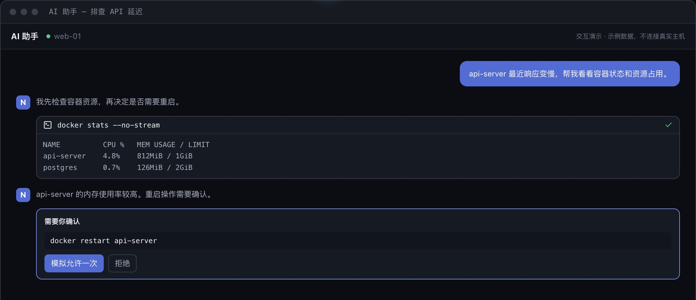
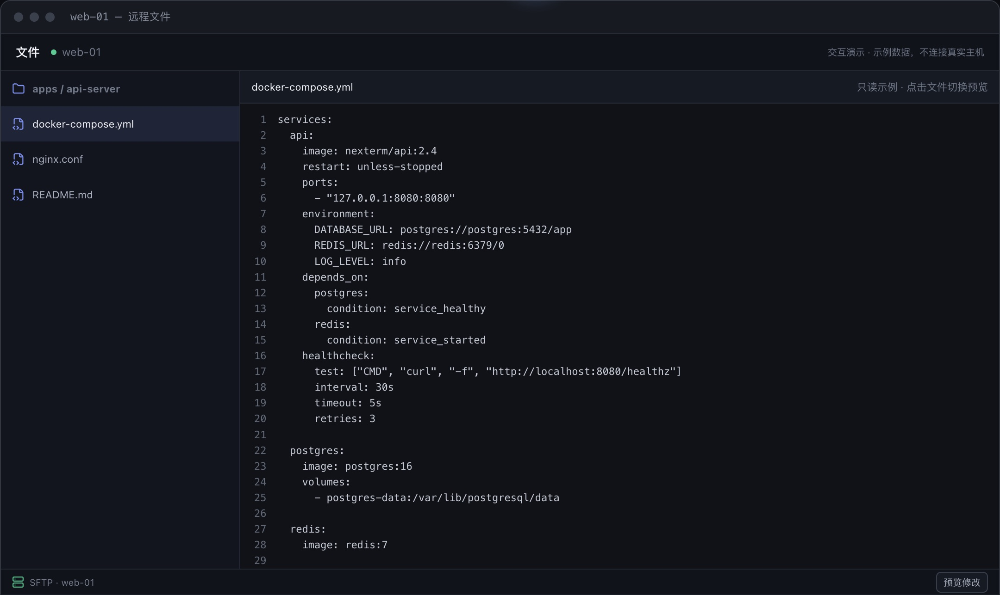
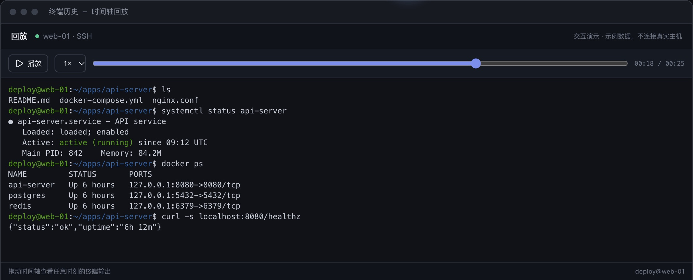

# 功能说明

**中文** | [English](features.en.md) · [返回 README](../README.md)

图片使用示例数据，可在[官网](https://nexterm.work/)体验在线演示。

## 终端

- **持久终端**：关闭标签、退出 App 或断网后继续运行，可在「后台会话」接管或终止，也可从任意已登录设备接管并补回输出。桌面端本机终端，以及启用后的 SSH 和受管设备会话支持；持久终端组件未就绪时新建的是临时终端并标明原因，临时终端断开即结束。WinRM 非交互终端随关闭结束。移动端没有本机终端。
- **会话状态**：徽章、顶栏收件箱和桌面系统通知指出需要你的会话，来源是终端响铃、程序通知和你保存的规则，不会从屏幕内容猜测；左侧导航栏的「会话总览」是状态墙（手机启动时默认显示）。
- **多设备**：多台设备同时观看和输入同一终端，尺寸跟随最后输入的设备，跟随的设备也可点「用本机尺寸」改用自己的尺寸。手机查看桌面本机终端，需在「设置」开启「向服务器账号开放本机终端」：这会把该电脑当前用户的命令行权限交给该服务器账号的管理方，请只对信任的服务器开启。
- **终端工具**：命令块、历史搜索与回放（录像可导出为 asciicast，或按终端里看到的样子导出纯文本，可选每行时间戳）、命令广播、片段（支持多步和参数，在当前终端运行时依次发送各步，不等待上一步结束）、可嵌套分屏；跳转面板（Ctrl/Cmd+Shift+P）按需要程度排序会话，也能搜索命令历史。被换行或边框折断的链接也能识别，并汇总在链接面板；链接默认用系统浏览器打开，可改为在 NexTerm 内打开（浏览器模式只能嵌入 https 页面，移动端始终用系统浏览器）。输出中的文件路径（如 `src/a.ts:12:5`、`/etc/nginx/nginx.conf`、编译器与 grep 的 `路径:行:列`、Python 的 `File "x.py", line 12`，Windows 会话中还有 `C:\x\y.cs(12,5)`）可以像链接一样在文件编辑器中打开并跳到对应行；相对路径按 shell 上报的当前目录解析，只在打开时检查文件是否存在，容器终端和已切到其他主机的 shell 不提供。快速选择（Ctrl/Cmd+Shift+Y，或工具栏菜单）为屏幕上的链接、路径、Git 哈希、IP 地址、UUID 和容器 ID 标上字母，按字母复制，按 Shift+字母填入提示符（不回车），触屏上可直接点按标签。会话侧栏（Ctrl/Cmd+Shift+B）列出当前主机的端口、最近文件和命令记录；复制模式（Ctrl/Cmd+Shift+X，仅桌面端和浏览器）用 vi 键在回滚缓冲区中移动光标、搜索并按字符、整行或矩形选择后复制，期间按键不会发给终端里的程序；环境设为生产的主机，终端窗格和标签以红色标出。
- **本机 Shell**：本机资产的「默认 Shell」可从本机检测到的 Shell 中选择（Windows 上为 PowerShell 7、Windows PowerShell、cmd、已安装的 WSL 发行版和 Git Bash，其他系统为 /etc/shells 中的 Shell），也可自填路径和启动参数（如 `wsl.exe -d Ubuntu`、`bash.exe --login -i`）；多用户服务端不提供本机资产。持久终端中的 zsh、bash、fish 和 PowerShell 会上报当前目录、命令起止和退出码；PowerShell 照常加载用户配置文件并保留原有提示符。
- **锁定界面**：跳转面板的「锁定 NexTerm」、「设置 → 锁定 NexTerm」或自行绑定的快捷键（默认未绑定，Ctrl/Cmd+Shift+L 已用于锁定凭据库）会隐藏整个界面并拦截所有输入，终端、传输和持久终端在后台继续运行。桌面端和移动端用凭据库保护密码解锁（需先设置保护密码，移动端可用生物识别），浏览器模式用账号密码解锁，密码在浏览器本地验证、不会保存。可设置闲置若干分钟后自动锁定（本机设置，默认关闭）。锁定期间系统通知只显示「NexTerm 已锁定」和条数；刷新页面或重启 App 后仍保持锁定。它防的是离开座位时被旁人查看或操作，不能代替操作系统锁屏。

## AI 助手

20+ 工具覆盖命令、文件、Docker 和终端输出；写操作执行前展示命令或 diff，支持计划模式、按主机和路径授权、定时任务和长期记忆；兼容任意 OpenAI 接口，内置 DeepSeek、Kimi、GLM、Ollama 预设。可选的本地信息脱敏见 [AI 信息脱敏](ai-privacy.md)。

## 日常运维

- **文件、容器与数据库**：SFTP/WinRM/设备文件浏览与在线编辑（可按资产开启覆盖前 `.nexterm-bak` 备份，作用于 AI 写文件与 Compose 重新部署）；Docker 容器、日志与镜像，可按时间合并多个容器的日志，Compose 重新部署前显示要执行的命令和目录、确认后才执行，SSH 主机上可转发并打开容器发布的端口；MySQL/MariaDB、PostgreSQL 与 Redis；本地转发与 SOCKS5；从 `~/.ssh/config` 或 Termius（仅 macOS）导入主机，桌面版还可导入 PuTTY（Windows 注册表或 `.reg` 导出）、MobaXterm（`MobaXterm.ini`）、Xshell（`.xsh` 会话文件夹）与 SecureCRT（`Sessions` 文件夹）的 SSH 会话，来源文件夹映射为分组；导入前预览冲突，不导入密码与 `.ppk` 私钥。
- **远程桌面**：RDP 和 VNC 资产在 NexTerm 内打开，可经 SSH 主机或受管设备中转；服务器的 TLS 证书在首次连接时确认指纹后固定，证书变化时拒绝连接并要求重新确认；可手动收发文本剪贴板（可按资产关闭），支持只读查看和发送组合键，RDP 服务器支持时还可在连接中临时调整分辨率；连接记录写入审计日志。VNC 服务器不提供 X.509 TLS 时连接不加密，建议经 SSH 主机中转。
- **主机诊断**：主机详情页查看监听端口和进程（可搜索、分页，端口可按对外或仅本机筛选，端口和进程可互相跳转，进程可按树状查看，结束进程需确认并写入审计日志），从主机发起 TCP 或 HTTP 连通性测试，并搜索该主机已录制的终端输出。端口发现默认关闭；开启后终端连接期间定期在远端执行 `ss`/`netstat`，发现新端口时提示，点击后才建立只绑定 127.0.0.1 的临时转发，会话关闭时移除；浏览器模式下转发建在服务器上，只有服务器本机能访问。

## 设备、分享与自托管

- **设备与分享**：一行命令接入设备代理（见[设备接入](device-agent.md)），设备主动外连并上报指标；终端可分享为限时公开链接或分享给注册用户（仅终端），默认只读、可随时吊销。服务端可按 CPU、内存、磁盘使用率阈值和离线时长对受管设备告警，告警显示在收件箱和桌面通知中，不发送邮件或 Webhook。
- **自托管**：多用户与 TOTP 双因素认证；加密同步（状态规则、AI 技能默认同步，AI 记忆和定时任务在「设置 → 账号与同步」单独开启，加密边界见[安全说明](security.md)）；凭据保险库；审计日志，审计时间线合并审计、命令和设备上下线记录，可筛选并导出 CSV 或 JSON；SQLite、PostgreSQL、MySQL、MariaDB。浏览器模式下终端和工作区保存在服务端。

## 截图

| AI 助手 | 远程文件 | 终端回放 |
| --- | --- | --- |
|  |  |  |
