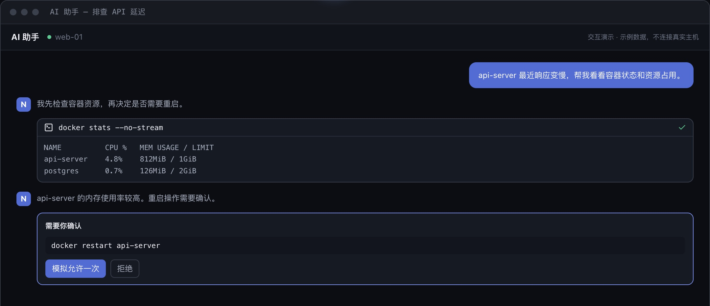
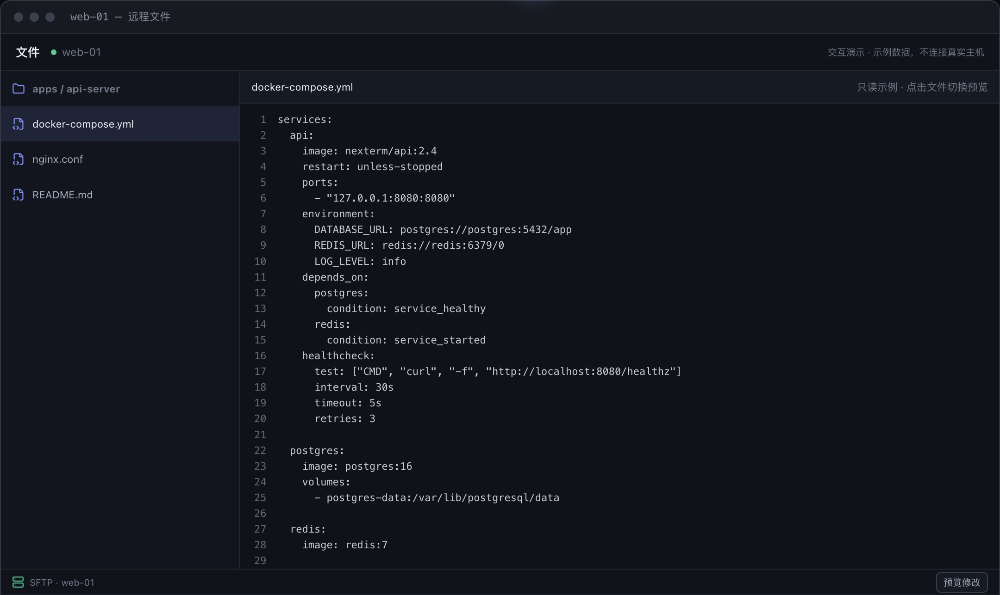
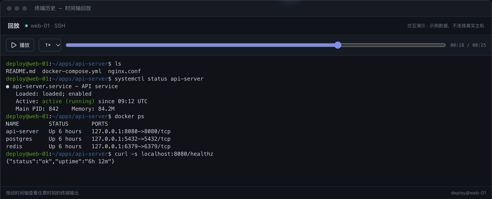

# 功能说明

**中文** | [English](features.en.md) · [返回 README](../README.md)

图片使用示例数据，可在[官网](https://nexterm.work/)体验在线演示。移动端（Android、iOS、iPadOS）为预览版，没有本机终端。

## 终端

- **持久终端**：关闭标签、退出 App 或断网后继续运行，可在「后台会话」接管或终止，也可从任意已登录设备接管并补回输出。支持桌面端本机终端，以及启用后的 SSH 和受管设备会话；持久终端组件未就绪时新建的是临时终端并标明原因，临时终端断开即结束。
- **Telnet**：为交换机、路由器等旧设备建 Telnet 资产（默认端口 23），只有终端，是临时终端，暂不支持经跳板机。Telnet 不加密，账号密码和终端内容都以明文传输，只应在可信网络中使用。
- **会话状态**：徽章、顶栏收件箱和系统通知提示需要你的会话（来源是终端响铃、程序通知和你保存的规则，不会从屏幕内容猜测）；「会话总览」是状态墙，OSC 9;4 进度显示为进度环。
- **多设备**：多台设备可同时观看和输入同一终端。手机查看桌面本机终端需在「设置」开启「向服务器账号开放本机终端」：这会把该电脑当前用户的命令行权限交给该服务器账号的管理方，请只对信任的服务器开启。
- **终端工具**：命令块与一键 AI 解释错误、历史搜索与回放（可导出 asciicast 或纯文本）、命令广播、多步片段、可嵌套分屏与布局模板、跳转面板（Ctrl/Cmd+Shift+P）、链接与文件路径识别、快速选择、复制模式、会话侧栏（端口、最近文件、命令记录，可选主机监控，默认关闭）；生产环境主机以红色标出。
- **关键词高亮与外观**：在「设置 → 终端」按文本或正则高亮输出（默认关闭），深色和浅色各选配色，可导入 iTerm2、Windows Terminal、Ghostty/kitty 主题；规则与配色随账号同步。
- **终端内文件传输**：支持 [trzsz](https://trzsz.github.io/)（`trz` 上传、`tsz` 下载），每次传输先在本机确认，不覆盖已有文件，不支持 ZMODEM。可在「设置 → 终端 → 文件传输」关闭。
- **本机 Shell**：本机资产可选检测到的 Shell 或自填路径和启动参数；多用户服务端不提供本机资产。
- **锁定界面**：「锁定 NexTerm」隐藏界面并拦截输入，终端在后台继续运行，可设闲置自动锁定。它防的是离开座位时被旁人查看，不能代替操作系统锁屏。

## AI 助手

20+ 工具覆盖命令、文件、Docker 和终端输出，写操作执行前展示命令或 diff，支持计划模式、按主机和路径授权、定时任务和长期记忆。权限模式有只读、读写、自动执行和完全放行（除禁止的操作外直接执行，命中拦截规则仍询问，生产环境按自动执行处理，定时任务不使用）。单轮最大步数可在设置中调整（默认 999），达到上限时暂停并可继续。兼容任意 OpenAI 接口，内置 DeepSeek、Kimi、GLM、Ollama 预设。在终端按 Ctrl+Shift+G（macOS 为 Cmd+I）用自然语言生成命令，只填入提示符、不自动执行，生产环境主机填入前会再次确认。可选的本地信息脱敏见[安全说明](security.md#ai-信息脱敏)。

## 日常运维

- **文件、容器与数据库**：SFTP/WinRM/设备文件浏览与在线编辑；Docker 容器、日志、镜像与 Compose（重新部署前确认命令）；MySQL/MariaDB、PostgreSQL 与 Redis；本地转发与 SOCKS5。
- **主机导入**：从 `~/.ssh/config`、Termius（仅 macOS）导入主机，桌面版还可导入 PuTTY、MobaXterm、Xshell 和 SecureCRT 的 SSH 会话；导入前预览冲突，不导入密码与 `.ppk` 私钥。
- **远程桌面**：RDP 和 VNC 在 NexTerm 内打开，可经 SSH 主机或受管设备中转，TLS 证书首次确认指纹后固定。VNC 服务器不提供 X.509 TLS 时连接不加密，建议经 SSH 主机中转。
- **主机诊断**：主机详情页查看监听端口和进程、发起 TCP 或 HTTP 连通性测试、搜索该主机已录制的终端输出；结束进程需确认并写入审计日志。端口发现默认关闭。
- **主机服务与日志**：管理 Linux systemd 与 Windows 服务（写操作受生产环境确认保护并写入审计日志），多主机日志可跟随 journalctl、文件、Docker 容器和 Windows 事件日志。

## 设备、分享与自托管

- **设备与分享**：一行命令接入设备代理（见[设备接入](device-agent.md)）；终端可分享为限时公开链接或分享给注册用户，默认只读、可随时吊销；受管设备可按 CPU、内存、磁盘阈值和离线时长告警，只显示在收件箱和桌面通知中，不发送邮件或 Webhook。
- **自托管**：多用户与 TOTP 双因素认证、凭据保险库、审计日志与时间线（可导出 CSV 或 JSON）、SQLite、PostgreSQL、MySQL、MariaDB；登录服务端时可设 HTTP、SOCKS4 或 SOCKS5 代理。浏览器模式下终端和工作区保存在服务端。
- **加密同步**：状态规则、AI 技能默认同步，AI 记忆和定时任务在「设置 → 账号与同步」单独开启。同步不是端到端加密，范围见[安全说明](security.md)。

## 截图

| AI 助手 | 远程文件 | 终端回放 |
| --- | --- | --- |
|  |  |  |
